# Setl8

**An on-chain prop-trading challenge platform on Solana.**
The evaluation fee, the pass/fail record and the payouts are held by a smart contract instead of the operator, so anyone can check them on a block explorer.


B.Tech project, Indian Institute of Technology Kharagpur, November 2026.
**Author:** Soumyadip Mistry (Roll No. 23CE36019) · **Supervisor:** Dr. Sandip Chakraborty, Department of Computer Science and Engineering

---

> **Status: working devnet prototype. Test tokens only. Not independently audited. Not ready for mainnet.**
> See [Limitations](#limitations) for exactly what the evidence in this repository does and does not show.

## Contents

- [Overview](#overview)
- [How it works](#how-it-works)
- [Challenge rules](#challenge-rules)
- [Architecture](#architecture)
- [Smart contract](#smart-contract)
- [Deployed on devnet](#deployed-on-devnet)
- [On-chain evidence](#on-chain-evidence)
- [Verify it yourself](#verify-it-yourself)
- [Build and run](#build-and-run)
- [Limitations](#limitations)
- [Future work](#future-work)

## Overview

In a proprietary-trading challenge, a trader pays a fee, trades a simulated account under strict loss and profit rules and, if successful, is funded and shares profit. The trader has to trust the operator on three points that are hard to check from outside: that the rules were applied as published, that the pass/fail record is not altered afterwards, and that payouts are actually funded.

Setl8 moves those three things on-chain:

| Concern | How Setl8 handles it |
| --- | --- |
| Where the fee goes | Split by the program in one transaction: 35% to the protocol wallet, 65% to a payout vault |
| Pass/fail record | Written as a permanent `PhaseResult` account, one per wallet per phase, with a result hash |
| Payouts | Queued on-chain and released through a time-gated, permissionless heartbeat |

The trading itself is simulated and evaluated off-chain by a rule engine. Scope is leveraged trading only (crypto, metals, indices, forex; up to 50x, capped per market).

## How it works

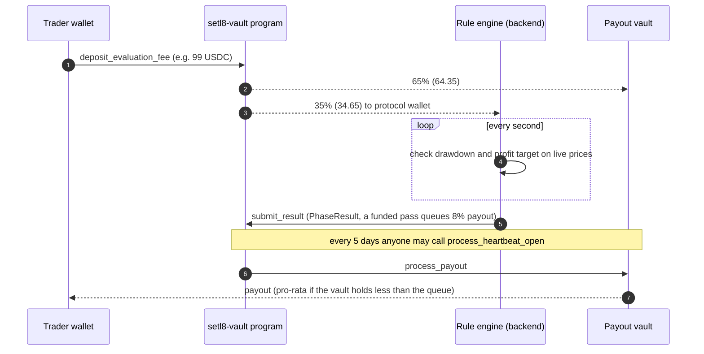

## Challenge rules

Values come from `packages/constants`.

| Rule | Value |
| --- | --- |
| Profit target | 8% of starting balance |
| Maximum drawdown | 8%, static |
| Trailing drawdown | 4% from peak, after winning trades; resets to static after a 1% loss |
| Phases | 1 evaluation + 5 funded |
| Leverage | Up to 50x-200x, capped per market |
| Position fee | max(starting balance, position size) × 0.035% |
| Payout | 8% of account size per funded pass, up to 40% in total |
| Evaluation fee split | 35% protocol wallet, 65% payout vault |
| Vault reserve | 25% locked against admin withdrawal |
| Daily stop-out | None; only the overall drawdown applies |

## Architecture

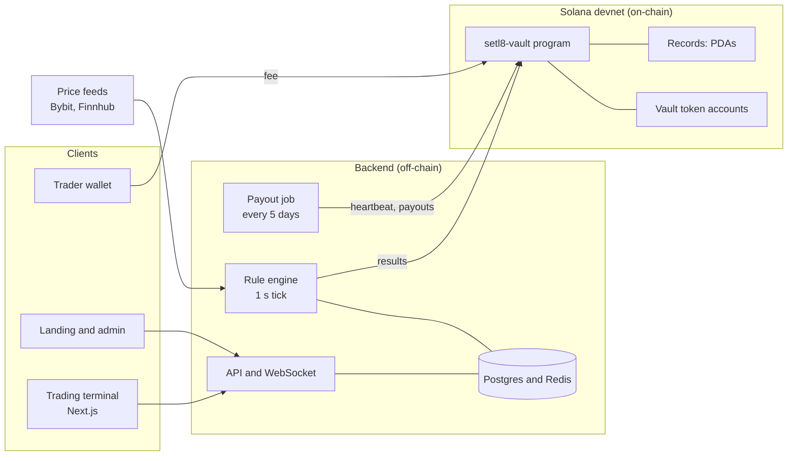

The chain holds only fees, results and payouts. Attempt and position state lives in Postgres.

### Repository layout

| Path | Contents |
| --- | --- |
| `programs/setl8-vault` | Anchor program (Rust) |
| `backend` | Fastify API, rule engine (BullMQ), on-chain submitter, audit and ledger scripts (`backend/scripts`) |
| `apps/trade` | Trading terminal (Next.js) |
| `apps/web`, `apps/admin` | Landing site and operator panel (Next.js) |
| `apps/mobile` | Expo / React Native client for the same backend |
| `packages/constants` | Shared challenge rules and package definitions |
| `packages/types` | Shared TypeScript enums and interfaces |
| `scripts` | Devnet setup and demo scripts (initialise the program, token accounts, admin transfer, demo transactions) |
| `tests/security` | Vitest API security tests; they run against a live backend |
| `vendor` | Patched copies of Rust crates so the program builds with the Solana toolchain (`[patch.crates-io]` in `Cargo.toml`) |
| `docs` | On-chain ledger, run logs, audit output, terminal spec, screenshots |

## Smart contract

`setl8-vault` is an Anchor program of about 1,400 lines. Funds sit in token accounts whose authority is a program-derived address, so no private key controls them.

**Accounts (PDAs)**

| Account | Holds |
| --- | --- |
| `VaultState` | admin, supported mints, fee split, reserve %, queued payout total, heartbeat state |
| Payout vault | authority of the vault token accounts |
| `TraderAccount` | current phase, status (Active / Passed / Failed / Graduated), account size |
| `PhaseResult` | one permanent result per wallet per phase: balances, P&L, drawdown, result hash |
| `PayoutRequest` | payout amount and status (Queued, PartiallyPaid, Completed) |

**Instructions**

| Caller | Instruction | Effect |
| --- | --- | --- |
| Trader | `deposit_evaluation_fee` | Splits the fee 35% / 65%; a new attempt is allowed only after a failed one |
| Admin | `submit_result_no_payout`, `submit_result_with_payout` | Records a phase result; a funded pass queues an 8% payout |
| Anyone | `process_heartbeat_open` | Opens the payout window, only 5 days after the last one; pro-rata if the vault is short |
| Anyone | `process_payout`, `process_heartbeat_close` | Sends one queued payout; closes the window |
| Admin | `admin_withdraw` | Only above the larger of the 25% reserve and the queued payouts |
| Admin | `request` / `execute` / `cancel_emergency_withdraw` | 48-hour timelock; execution drains the vault and pauses the program |
| Admin | `unpause`, `update_config` | Resume after an emergency; change settings (instant) |

The split is computed in integer basis points with checked arithmetic. **The contract does not verify trading**: the admin key supplies the result numbers and the contract stores them with a hash.

## Deployed on devnet

| Item | Address |
| --- | --- |
| Program | [`C3bvX2hkL76wXNobbyJPV5JpEPRFc3ksA4khR8WU9Rnk`](https://solscan.io/account/C3bvX2hkL76wXNobbyJPV5JpEPRFc3ksA4khR8WU9Rnk?cluster=devnet) |
| VaultState | [`Ho2fSDux2njBu9wNhkiURsBSSUWcgkSyV38HbYj2xu2v`](https://solscan.io/account/Ho2fSDux2njBu9wNhkiURsBSSUWcgkSyV38HbYj2xu2v?cluster=devnet) |
| Payout vault PDA | [`BMHggqxZUgjMEwev5z8YDbFsd6LvTFdZu2SB7B4n7Z1e`](https://solscan.io/account/BMHggqxZUgjMEwev5z8YDbFsd6LvTFdZu2SB7B4n7Z1e?cluster=devnet) |
| Vault USDC token account | [`5sE1nc3CKuE4cLYAuT2Ltkps5vivPrrG94SkwnAfnEVF`](https://solscan.io/account/5sE1nc3CKuE4cLYAuT2Ltkps5vivPrrG94SkwnAfnEVF?cluster=devnet) |
| Admin, protocol wallet and upgrade authority | [`SL89fcsKAuWYtkEJah86WLLBxCiHd1DeNczpsDjSHDJ`](https://solscan.io/account/SL89fcsKAuWYtkEJah86WLLBxCiHd1DeNczpsDjSHDJ?cluster=devnet) |

## On-chain evidence

All 32 transactions that touched the program or the vault token account are listed, oldest first, in [`docs/ONCHAIN_LEDGER.txt`](docs/ONCHAIN_LEDGER.txt) with signer, instruction, token deltas and an explorer link. All 32 succeeded.

| Wallet | Account | Evaluation | Funded phases | Paid |
| --- | --- | --- | --- | --- |
| demo-trader-1 | 10k | Passed, +1,106.00 | Phase 1 passed | 800 USDC |
| demo-trader-2 | 25k | Passed, +2,662.50 | Phase 1 passed | 2,000 USDC |
| demo-trader-3 | 75k | Passed, +7,680.00 | Phases 1 and 2 passed | 12,000 USDC |
| demo-trader-4 | 10k | Failed, −811.00 | none | none |
| demo-trader-5 | 25k | Passed, +2,355.00 | none yet | none |
| `2CRtrR…` | 10k, then 25k | Failed, −961.28 | new attempt active | none |

**Total paid: 14,800 USDC in four payouts.** After the payouts the vault token account held 186,240.65 test USDC. A read-only audit script ran 17 checks of on-chain state and passed 17 of 17.

### Solscan captures

Screenshots of the live Solscan pages (devnet, taken 11 November 2026). Each one is linked to the page it shows.

| | |
| --- | --- |
| [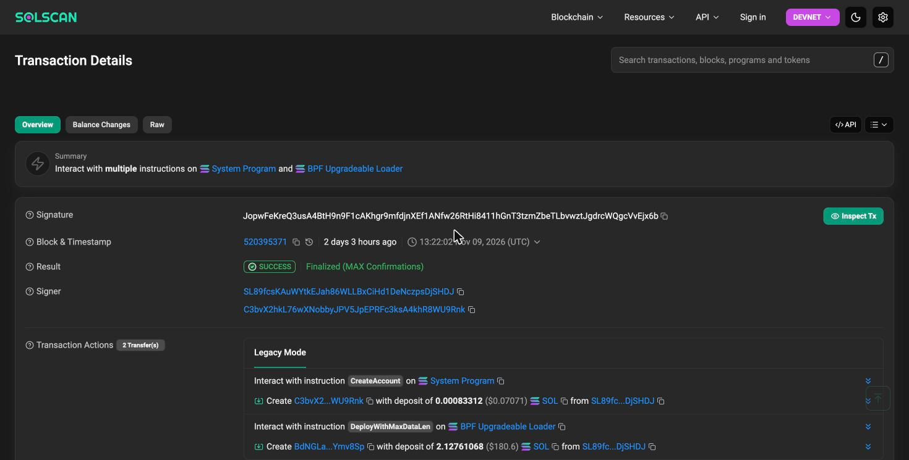](https://solscan.io/tx/JopwFeKreQ3usA4BtH9n9F1cAKhgr9mfdjnXEf1ANfw26RtHi8411hGnT3tzmZbeTLbvwztJgdrcWQgcVvEjx6b?cluster=devnet)<br>**Fig. 1** Deploy, 9 Nov 13:22 UTC | [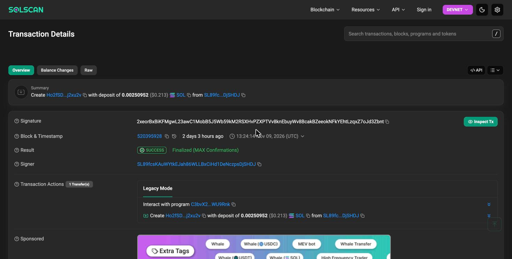](https://solscan.io/tx/2xeorBxBiKFMgwL23awC1MobB5J5Wb59kM2RSXHvPZXPTVv8knEbuyWv8BcakBZeeokNFkYEhtLzqxZ7oJd3Zbnt?cluster=devnet)<br>**Fig. 2** Initialize, creates `VaultState` |
| [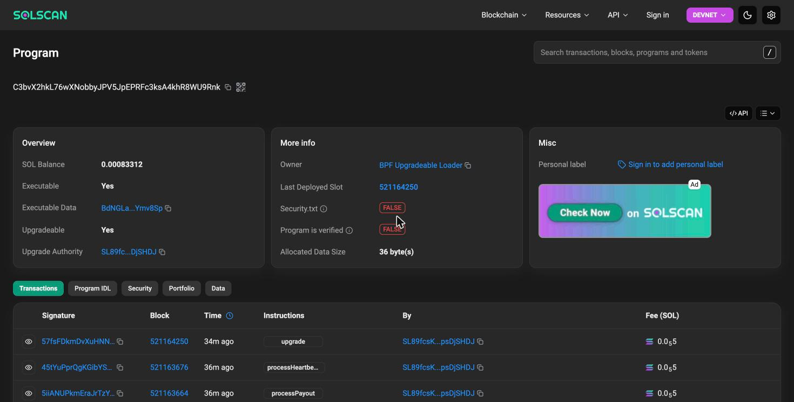](https://solscan.io/account/C3bvX2hkL76wXNobbyJPV5JpEPRFc3ksA4khR8WU9Rnk?cluster=devnet)<br>**Fig. 3** Program account | [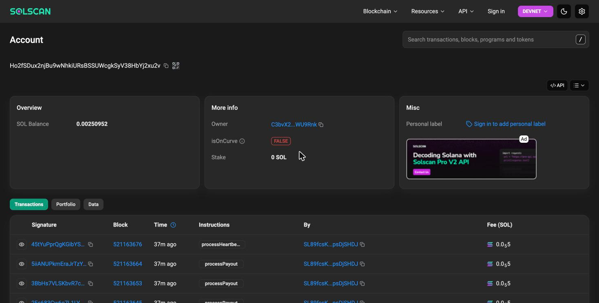](https://solscan.io/account/Ho2fSDux2njBu9wNhkiURsBSSUWcgkSyV38HbYj2xu2v?cluster=devnet)<br>**Fig. 4** `VaultState` |
| [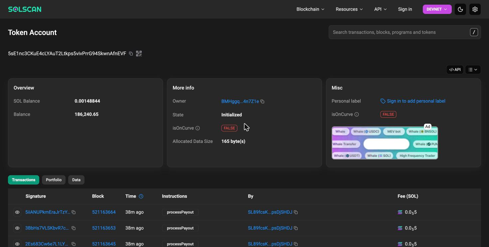](https://solscan.io/account/5sE1nc3CKuE4cLYAuT2Ltkps5vivPrrG94SkwnAfnEVF?cluster=devnet)<br>**Fig. 5** Vault token account | [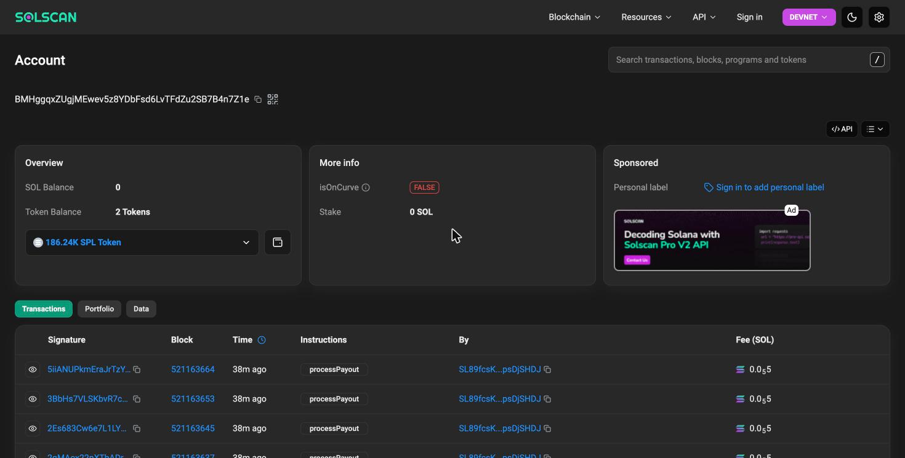](https://solscan.io/account/BMHggqxZUgjMEwev5z8YDbFsd6LvTFdZu2SB7B4n7Z1e?cluster=devnet)<br>**Fig. 6** Payout vault PDA |
| [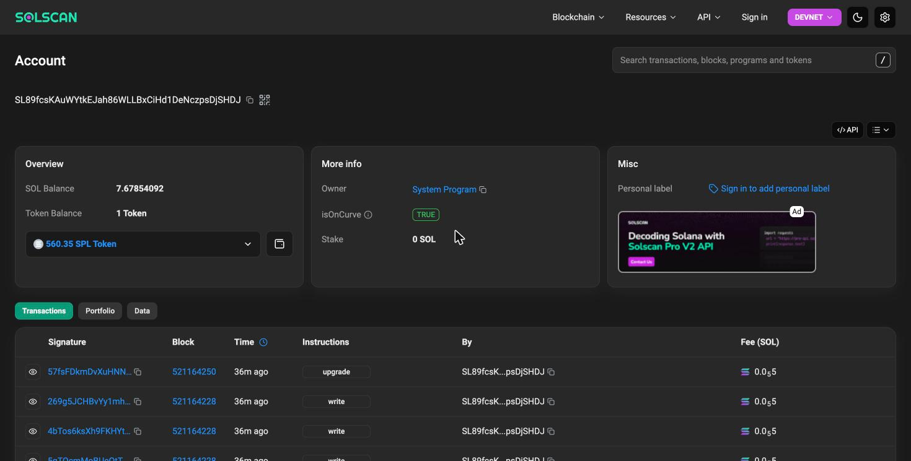](https://solscan.io/account/SL89fcsKAuWYtkEJah86WLLBxCiHd1DeNczpsDjSHDJ?cluster=devnet)<br>**Fig. 7** Protocol, admin and upgrade-authority wallet | [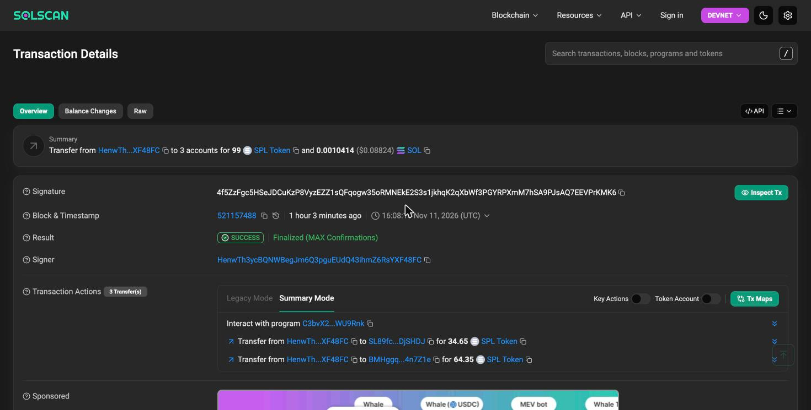](https://solscan.io/tx/4f5ZzFgc5HSeJDCuKzP8VyzEZZ1sQFqogw35oRMNEkE2S3s1jkhqK2qXbWf3PGYRPXmM7hSA9PJsAQ7EEVPrKMK6?cluster=devnet)<br>**Fig. 8** Fee deposit, 34.65 / 64.35 split |
| [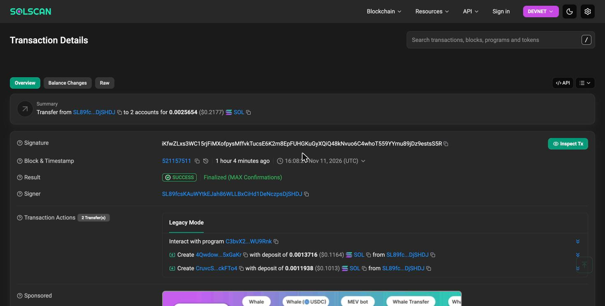](https://solscan.io/tx/iKfwZLxs3WC15rjFiMXofpysMffvkTucsE6K2m8EpFUHGKuGyXQiQ48kNvuo6C4whoT559YYmu89jDz9estsS5R?cluster=devnet)<br>**Fig. 9** Result with queued payout | [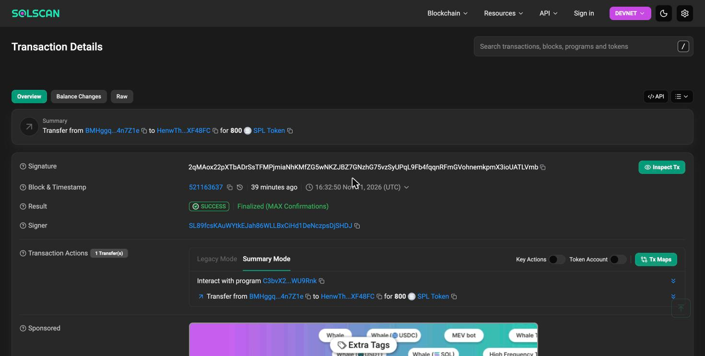](https://solscan.io/tx/2qMAox22pXTbADrSsTFMPjmiaNhKMfZG5wNKZJBZ7GNzhG75vzSyUPqL9Fb4fqqnRFmGVohnemkpmX3ioUATLVmb?cluster=devnet)<br>**Fig. 10** Payout, 800 USDC |
| [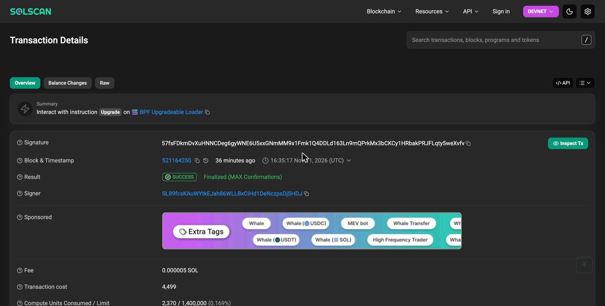](https://solscan.io/tx/57fsFDkmDvXuHNNCDeg6gyWNE6U5xxGNmMM9x1Fmk1Q4DDLd163Ln9mQPrkMx3bCKCy1HRbakPRJFLqty5weXvfv?cluster=devnet)<br>**Fig. 11** Production build restored, 11 Nov 16:35 UTC | |

## Verify it yourself

You can check the evidence without running any trading code. All commands run from `backend/` and are **read-only**.

```bash
# 17-check audit of program and vault state
pnpm exec tsx scripts/onchain-check.ts [trader-wallet] [rpc-url]

# full transaction ledger with token deltas, PhaseResults, PayoutRequests
pnpm exec tsx scripts/onchain-ledger.ts [trader-wallet] [usdt-mint] [rpc-url]
```

Or open the program, `VaultState` and vault addresses above on a Solana explorer (devnet) and compare the transaction list with [`docs/ONCHAIN_LEDGER.txt`](docs/ONCHAIN_LEDGER.txt).

## Build and run

**Prerequisites:** Node.js 20 or newer, pnpm 10, Rust and the Solana CLI 1.18 with platform-tools v1.51 for the program, and Postgres and Redis for the backend.

These commands were run on a fresh install of this repository, from the repository root, and passed:

```bash
pnpm install
pnpm --filter backend prisma:generate            # generate the Prisma client
pnpm exec turbo typecheck --ui=stream            # types, constants, trade, web, admin, mobile
pnpm exec turbo build --ui=stream                # types, constants, trade, web, admin, and tsc --noEmit for the backend
cargo build-sbf --tools-version v1.51 --manifest-path programs/setl8-vault/Cargo.toml

pnpm --filter trade dev                          # http://localhost:3002
pnpm --filter admin dev                          # http://localhost:3003
pnpm --filter web dev                            # http://localhost:3000
```

Each of the three dev servers answered with HTTP 200. The root `.npmrc` hoists `@solana/wallet-adapter-react` because `apps/trade/next.config.mjs` aliases it to the workspace root.

The backend is started with `pnpm --filter backend dev`. It needs a running Postgres and Redis, the schema from `pnpm --filter backend prisma:migrate`, and `backend/.env` filled in from `.env.example` (RPC URL, database URL, price-feed keys, protocol keypair path). That command was not run for this submission. No keys, tokens or RPC credentials are committed to this repository.

## Limitations

This is a self-review, not an audit. Please read the evidence with these points in mind.

- **Scripted demo results.** The five demo wallets' results were submitted by a seed script with fixed numbers, not produced by the rule engine from live trading. They show that the program records results and pays; they do not show that the engine judged live trades correctly.
- **Temporary payout build.** The payouts ran under a temporary build with a 60-second heartbeat so they fit in one session. The 5-day production build was restored in place (final transaction in the ledger) and the audit passed afterwards. The 5-day gate has not yet been exercised with a real payout.
- **The chain does not verify trading.** Trust in a result rests on the admin key and the off-chain engine.
- **Single key.** One key is admin, protocol wallet and upgrade authority. Config changes are instant; the emergency withdraw has a 48-hour timelock and ignores the payout queue.
- **One result per wallet per phase.** `PhaseResult` is created with `init`, so a wallet that fails a phase and buys a new attempt cannot record a second result for the same phase until the program is upgraded.
- **Devnet helpers remain.** `force_close_vault_state` and `force_close_trader_account` are still in the program.
- **Not source-verified.** Solscan shows the program as "not verified"; the deployed bytecode has not been diffed against this source.
- **USDT is unregistered.** Only the USDC mint is accepted for admin deposits.
- **Terminal fixes not re-tested.** The chart candle fix and the order-form fee fix were not re-tested in a browser.
- **Security tests not passing without a backend.** The security tests are in `tests/security`. They need a running backend with Postgres and Redis (and `ADMIN_SECRET` and `JWT_SECRET` set to the backend's values), and they fail when no backend is running. They were not run against the final program for this submission.
- **Sample data in the web app.** The web app (`apps/web`) shows generated sample data for the leaderboard, recent payouts and leaderboard statistics when the leaderboard API call fails.

## Future work

- Fix the phase-result collision with an attempt counter (contract upgrade)
- Publish the engine's trade log against each result hash so results can be verified independently
- Multisig administration, remove devnet helpers, pay queued payouts first on emergency withdraw
- Reproducible build and hash comparison, then an external audit and fuzzing
- A real payout run under the 5-day heartbeat
- Register USDT as a second payment token, or drop it
- Advanced order types, netting and OCO in the terminal (specified, not built)

## Disclaimer

This is an academic prototype running on a test network with tokens that have no monetary value. It is not financial advice and is not intended for use with real funds.
